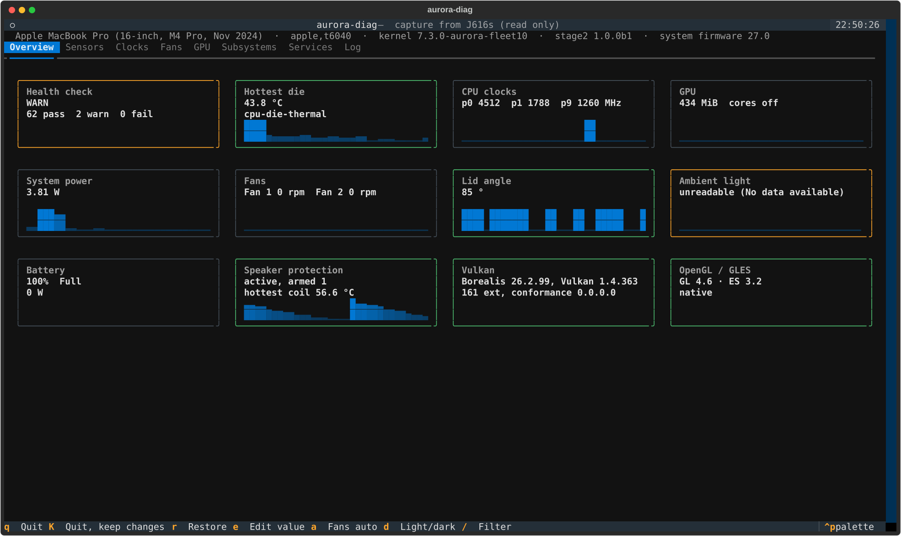
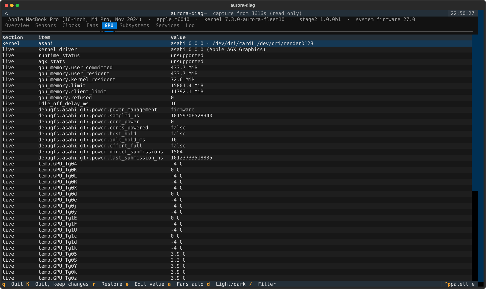
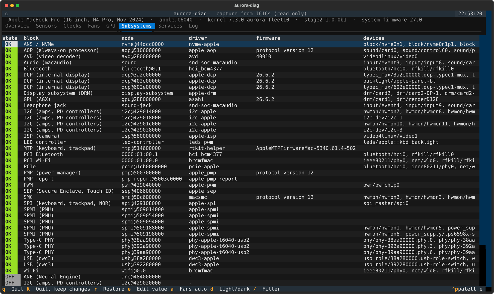
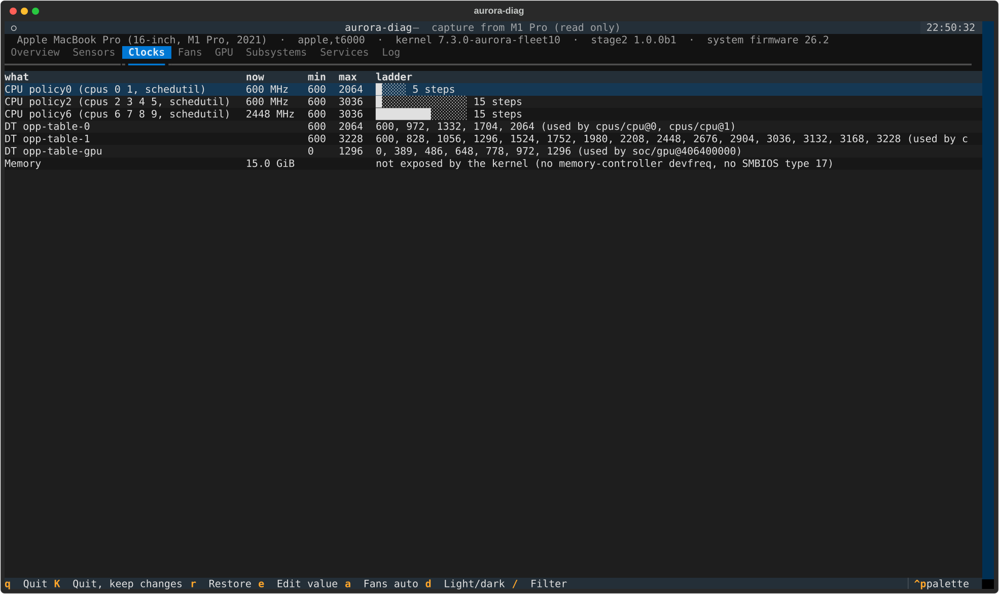
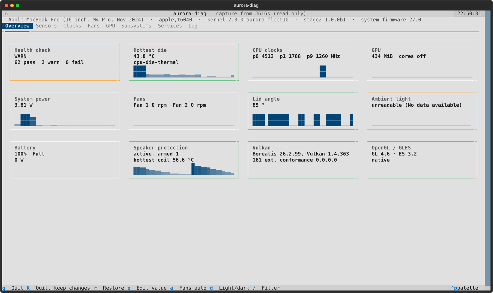

# aurora-diag

A bring-up Swiss Army knife for Linux on Apple silicon Macs. It shows everything the kernel and the drivers expose, says plainly what works and what does not, changes what may be changed through one logged and reversible path, and gives agents a fast, stable way to confirm that a new kernel did not regress anything.

It is a development tool. No image installs it and no package depends on it. Install it on purpose when you are testing or bringing up a machine.

## Quick start

    aurora-diag check                    # pass/warn/fail per block and service, exit 0/1/2
    aurora-diag snapshot -o good.json    # remember a known-good boot
    aurora-diag check --expect good.json # after a kernel update: anything missing fails
    aurora-diag diff good.json new.json  # what changed between two boots
    aurora-diag report -o .              # one JSON plus text file to attach to a bug
    aurora-diag tui                      # the dashboard

Reading needs no privileges, though root sees more (debugfs, dmesg, speakerguardd's state, the actuator's reports). Changes need root.

## What it covers

Nothing is a per-machine table. Every source walks a kernel class, bus or the device tree, so a driver that appears during bring-up shows up without a change here, and a machine without fans simply has no fan rows.

| area | source |
| --- | --- |
| sensors | every hwmon channel with label and unit (SMC temperatures, rails, power meters, battery, NVMe, amps), thermal zones and trip points, cooling devices, iio (lid angle, ambient light) |
| clocks | cpufreq policies (current, min, max, the DVFS ladder, time in state), every `opp-table*` in the device tree with the nodes that use it (CPU clusters, GPU), devfreq, memory size and whatever the kernel says about memory speed |
| fans | speed, target, limits; manual speed under a guard (below) |
| GPU | DRM devices, kernel driver version, the driver's own attributes (`agx_stats`, `gpu_memory`, ...), its debugfs reports, GPU temperatures, per-process GPU memory from fdinfo, busy percentage where the driver reports busy time |
| Vulkan | instance version, every device (name, driver name and ID, driver info, API version, conformance version), extension, feature and format counts, limits, memory heaps, queue families (`vulkaninfo`) |
| OpenGL, GLES | desktop GL core and compatibility and GLES through EGL with no display (surfaceless, then GBM): vendor, renderer, version, profile, GLSL version, every extension, key limits, and whether the path is native, Zink or llvmpipe. `eglinfo -B` and `glxinfo -B` are added when present |
| compliance | Vulkan conformance version and the features the spec makes mandatory for the claimed API version; GL 4.6 and GLES 3.2 limits against the spec minimums ([docs/COMPLIANCE.md](docs/COMPLIANCE.md)) |
| subsystems | every device-tree node with a compatible: enabled or not, the Linux device, driver bound or deferral reason, firmware version (DT or kernel log), class devices and /dev nodes it produced, the last kernel error about it. PCI functions (Wi-Fi, Bluetooth, SD) too |
| services | speaker protection (speakerguardd's live model: coil and magnet temperatures, governor, armed), fprintd and the Touch ID state files, PipeWire and WirePlumber per desktop user, iio-sensor-proxy, power profiles, Bluetooth, NetworkManager and any `aurora-*` unit |
| everything else | power supplies and Type-C/PD, backlight and LEDs (keyboard backlight), DRM connectors, input and HID devices, trackpad click strength, rfkill, network, V4L2, regulators, remote processors, platform drivers, module parameters, ALSA controls, allowlisted debugfs |

## Agents: check, snapshot, diff

`check` is the one command to run after booting a new kernel. Every probe runs under a deadline, so a hung sysfs read or a stuck `vulkaninfo` becomes a failed row, not a stalled run. It takes about a second on the M1 Pro, M2 and M4 Pro.

    $ aurora-diag check -q
    WARN  kernel   dmesg -p 3          3 error lines, last: Primary: ASoC: no backend DAIs enabled for Primary, ...
    WARN  sensors  aop-sensors-als ... unreadable: No data available
    WARN: 65 pass, 2 warn, 0 fail, 10 skip  (mbp, 7.3.0-aurora-fleet10, 0.5s)

- exit code 0 pass, 1 warn, 2 fail; `--json` for the full result; `-q` only warnings and failures; `-v` every row; `--only gpu,sep,service` to narrow it; `--no-api` skips Vulkan and GL.
- Without a baseline the verdicts come from the machine alone: a DT block no driver serves is a warning, a device whose driver did not bind is a failure, a failed unit is a failure, any `-p 3` line is a warning.
- `--expect FILE` compares with a snapshot from a known-good boot. Anything bound, active or present there that is gone now fails, and so does any new `-p 3` line. Known gaps that the baseline shares stop warning. The baseline is generated from the data (`snapshot`), never written by hand.

`diff OLD NEW` prints only what changed, each line marked `-` regression, `~` change or `+` improvement, and exits 2 on regressions, 1 on other changes, 0 when nothing changed. It covers drivers bound or lost, block state, firmware versions, class devices, new `-p 3` lines, services, clock ladders, sensor channels, Vulkan and GL versions, conformance and extension counts, and compliance findings.

The JSON formats (`check`, `snapshot`, `diff`, the log) carry a `schema` and a `version` field and are documented in [docs/SCHEMA.md](docs/SCHEMA.md).

## The dashboard

`aurora-diag tui` opens a tabbed dashboard (Overview, Sensors, Clocks, Fans, GPU, Subsystems, Services, Log) with status chips, live sparklines and the terminal's light or dark theme (`d` switches). It needs Textual (`python3-textual`, `python-textual`, `python3Packages.textual`); without it the plain curses view runs instead (`--curses` forces it).

`aurora-diag tui --dump FILE` captures what the dashboard shows (with ten seconds of samples), and `aurora-diag tui --snapshot FILE` shows such a capture on any machine, read only. The screenshots here are captures from the M4 Pro, M1 Pro and M2.

| | |
| --- | --- |
|  |  |
|  |  |

Keys: `e` edits the selected writable value on the Sensors tab, `r` restores this session's changes, `a` hands the fans back to the SMC, `/` filters, `q` quits and restores, `K` quits and keeps the changes.

## Changing things

Anything writable the kernel exposes can be changed through one write path. It reads the old value, writes, reads back, logs the change with before and after values, and records it in a journal under `/run/aurora-diag`. `aurora-diag restore` puts everything back (newest change first), `restore --from-log [--session ID]` does it from the log when the journal is gone, and `--hold`, the dashboard and the fan guard put their changes back when they exit.

    aurora-diag set ID VALUE [--hold] [--dry-run]
    aurora-diag fan list | set N RPM | auto
    aurora-diag haptic show | set PRESS RELEASE
    aurora-diag kbd [N]
    aurora-diag display status | notch on|off | brightness N|N% | reprobe CONNECTOR
    aurora-diag journal | restore [--from-log]

These stay read only whatever you ask:

- speaker protection: speakerguardd and speakersafetyd state, every ALSA control on the speaker path (volumes, unlock, V/I sense, amp gain, routing) and the speaker drivers' module parameters. The tool never opens a PCM, so it cannot play or record audio.
- thermal zone mode, emulated temperatures, critical and hot trip points
- battery and charger limits (only the charge thresholds and `charge_behaviour` can change)
- the boot chain: EFI variables, NVRAM, SPI NOR, block devices
- bind, unbind, remove and similar actions, `/sys/power`, debugfs and `/proc`

A machine whose device tree is not an Apple silicon one is read only unless you pass `--allow-unknown`.

**Fans.** `fan set` needs a kernel whose macsmc-hwmon probed with fan control enabled (`fanN_target` writable). Every manual speed runs under a guard that hands the fans back to the SMC when its lease runs out (10 minutes by default), when a die temperature passes `--max-temp` (90 C by default, never above 100 C), when die temperatures cannot be read for 5 seconds, or when the guard stops for any reason. It runs as a transient systemd unit whose `ExecStopPost` hands the fans back even after a crash. Fanless machines are refused.

**Trackpad click.** `haptic set PRESS RELEASE` changes the strength byte of the actuator's feature reports 0x22 and 0x23 live, on any HID device named as an actuator (MTP and SPI trackpads).

**Notch.** appledrm decides the notch when the DCP probes, so `display notch` takes effect from the next boot and the tool says so.

## Logs

As root the log goes to `/var/log/aurora-diag/aurora-diag.jsonl`, otherwise to `$XDG_STATE_HOME/aurora-diag/`. `aurora-diag log [-f] [--session ID] [--event set]` prints or follows it, `log-path` prints where it is, and `--json` puts the same records on stdout. The events are described in [docs/LOG.md](docs/LOG.md).

## Layout

One module per area, each one a generic discovery over the kernel's interfaces:

| module | role |
| --- | --- |
| `sysfs.py` | defensive reads (never raise, optional timeout), DT property decoding, the fake-root hook for tests |
| `sources.py` | the reading model and the generic class walkers (hwmon, iio, thermal, power supply, ...) |
| `clocks.py`, `gpu.py`, `glprobe.py`, `compliance.py` | clocks and ladders; GPU, Vulkan, GL (glprobe runs in its own process) and spec checks |
| `subsystems.py`, `services.py` | hardware blocks against the device tree; userspace services and Touch ID state |
| `check.py`, `snapshot.py`, `report.py`, `probe.py` | the agent side: verdicts, snapshots and diffs, bug reports, per-probe deadlines |
| `control.py`, `fans.py`, `haptics.py`, `display.py`, `audio.py` | the write path, its policy and journal; fan guard, click strength, display, speaker protection readout |
| `dashboard.py`, `tui_textual.py`, `tui.py` | dashboard data, the Textual UI, the curses fallback |
| `cli.py`, `log.py` | commands and the JSON-lines log |

## Tests

    make check

The tests run against a fake `/sys`, `/proc` and device tree (`AURORA_DIAG_ROOT`), so they need no hardware and no root.

## Packages

Opt-in packages for Fedora (`packaging/fedora`), Arch (`packaging/arch`) and NixOS (`packaging/nix`). Python 3 is the only hard dependency. Textual, vulkan-tools, alsa-utils and Mesa's demos are recommended.

## Licence

MIT
