# aurora-diag

A bring-up Swiss Army knife for Linux on Apple silicon Macs. It shows everything the kernel and the drivers expose, says plainly what works and what does not, changes what may be changed through one logged and reversible path, and gives agents a fast, stable way to confirm that a new kernel did not regress anything.

It is a development tool. No image installs it and no package depends on it. Install it on purpose when you are testing or bringing up a machine.

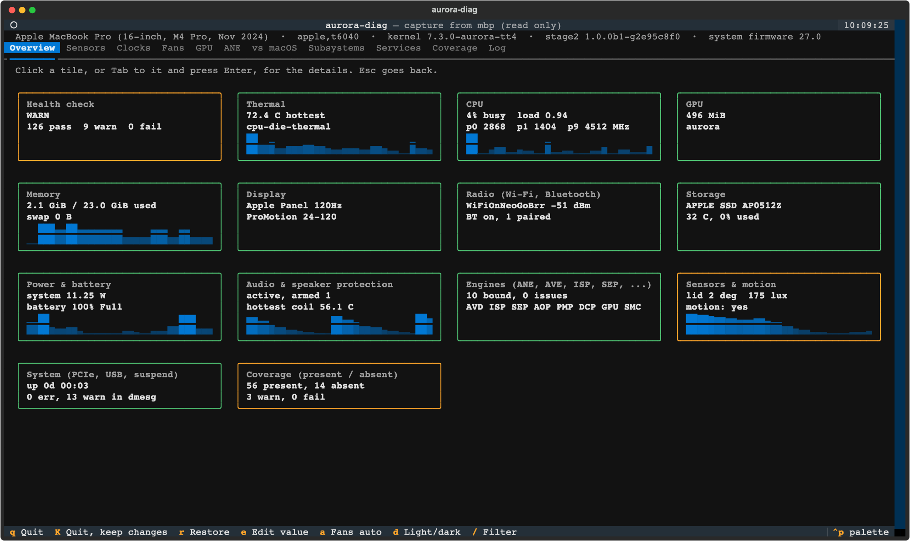

Every tile opens a live drill-down (click it, or Tab to it and press Enter). The same drill-down prints on the command line with `aurora-diag show NAME`, so an agent sees what a person sees:

| | |
| --- | --- |
| 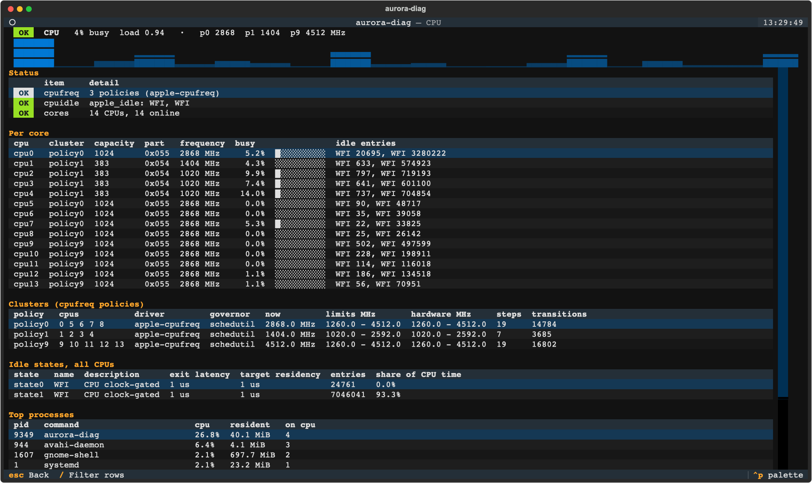 | 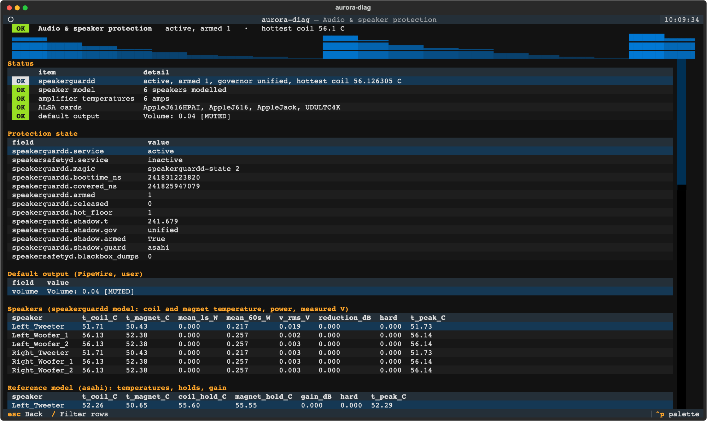 |
| 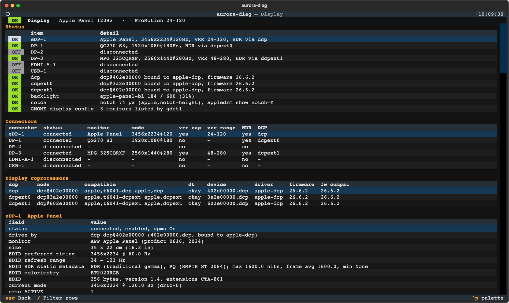 | 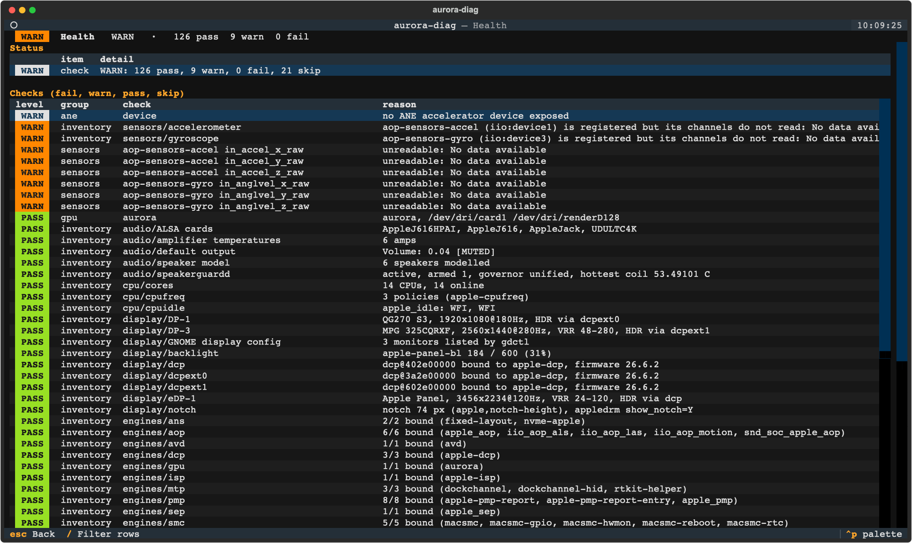 |

## Quick start

    aurora-diag check                    # pass/warn/fail per block and service, exit 0/1/2
    aurora-diag snapshot -o good.json    # remember a known-good boot
    aurora-diag check --expect good.json # after a kernel update: anything missing fails
    aurora-diag diff good.json new.json  # what changed between two boots
    aurora-diag report -o .              # one JSON plus text file to attach to a bug
    aurora-diag ane --json               # ANE status and saved benchmark, no workload launched
    aurora-diag compare --json           # live readings vs the J616s macOS baseline
    aurora-diag show cpu --json          # one category, as the dashboard's drill-down shows it
    aurora-diag show all                 # every category as text
    aurora-diag coverage                 # every item: present, or absent and why
    aurora-diag tui                      # the dashboard

Reading needs no privileges, though root sees more (debugfs, dmesg, speakerguardd's state, the actuator's reports). Changes need root.

## Demos

The first tile on the overview is **Demos**: one place to see and start every demo the machine can run, with what you will see, whether this machine can run it (and exactly why not), and a start and a stop. Nothing starts by itself, nothing plays audio, and the camera and microphone demos say so and run only after you start them. The same list is on the command line:

    aurora-diag demo                     # every demo: READY, or ABSENT and why
    aurora-diag demo motion              # live in the terminal until Ctrl-C (--seconds N, --json)
    aurora-diag demo avd                 # a quick run: output, then fps and bit-exactness vs macOS
    aurora-diag --dry-run demo ave       # print the command it would run
    aurora-diag demo camera-blur --stop  # the demo's own off command

| demo | kind | what you see |
| --- | --- | --- |
| motion | live | a spirit level and a tilting laptop from gravity, a compass from the integrated gyro z rate, rotation-rate bars, lid angle, ambient light and colour temperature (`z` re-zeroes) |
| whitepoint | live | ambient lux and colour temperature, the white point GNOME or KWin chose and applies (night light composed in), whether adaptation is on, available and active, the model's expected value, neutral/applied/model swatches from the blackbody factors with the numbers, a history of ambient vs applied K; `t` (or `demo whitepoint --set on/off`) flips the opt-in setting |
| speakers | live | speakerguardd's model per speaker, live, read only |
| ave, avd | quick run | hardware encode (avebench, 1080p H.264) and decode (avd-bench, bit-exact against software) with the fps next to the macOS number on the same machine |
| ane | quick run | MobileNetV1 on the Neural Engine and the CPU (aurora-try classify) |
| gpu, vkcube | quick run, app | glmark2 off-screen score; the Vulkan cube in a window |
| camera-blur, camera-frame, camera-denoise, web | app (camera) | aurora-try's camera effects and the browser viewer |
| captions-file, captions-live, mic-denoise | quick run, app (microphone) | whisper.cpp captions from a file or the microphone; the DeepFilterNet3 microphone |
| photos, upscale | quick run | aurora-try photo search and 4x upscale |

Programs are found, not assumed: PATH, the desktop user's `~/.local/bin` and `~/aurora-try-dev`, and the bench kits under `/var/tmp` and `/root`. Apps run as the desktop user in their session.

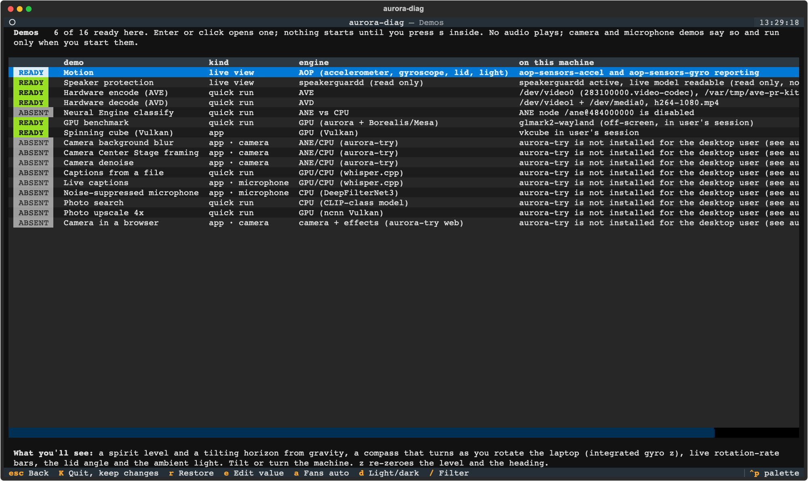
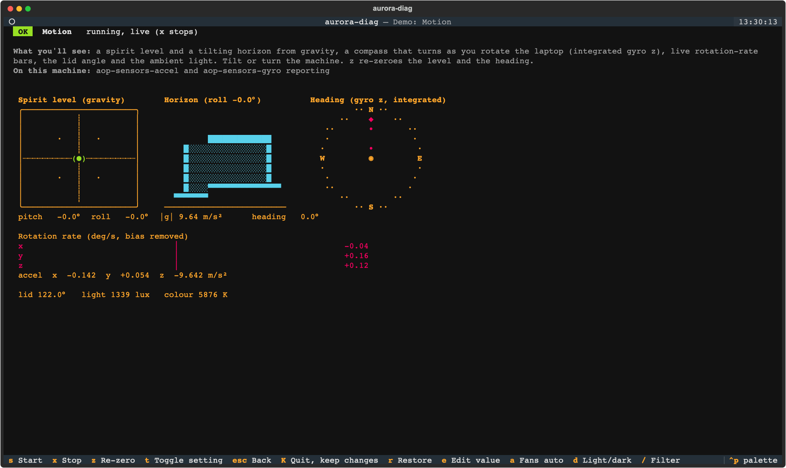

## What it covers

Sources walk a kernel class, bus or the device tree, so a driver that appears during bring-up shows up without a change here, and a machine without fans simply has no fan rows. ANE generation names use known SoC compatibles or an explicit generation attribute; the optional macOS comparison is specific to the J616s.

Everything is grouped into thirteen categories (`sections.py`). Each one lists its items as present or absent, and an absent item always says why ("no accel node under /aop@510600000 in the live device tree, and this kernel has no Apple motion driver"), so a missing sensor is never just a missing row:

| category | what it shows |
| --- | --- |
| health | the full `check`: every pass, warn, fail and skip with its reason |
| thermal | the hottest die, every temperature (hwmon and thermal zones) hottest first, trip points, zone governors, cooling devices, fans |
| CPU | per core: cluster, capacity, CPU part, frequency, live load and idle entries; per cluster: driver, governor, limits, ladder, transitions; idle states with their share of CPU time; top processes by CPU |
| GPU | DRM devices and the kernel driver (aurora), agx_stats, utilisation and frequency where exposed (else why not), GPU temperatures, Vulkan driver (Borealis) and GL renderer, clients |
| memory | RAM, swap, zram (algorithm, compression), DRAM speed and DVFS levels from the device tree, memory controller |
| display | per connector (eDP, DP, HDMI, USB): status, the DCP that drives it (dcp, dcpext0, dcpext1; bound or not), EDID monitor name, size, refresh range, HDR static metadata, colorimetry, current mode and refresh, every mode, KMS properties (vrr_capable, VRR_ENABLED, Colorspace, HDR_OUTPUT_METADATA, max bpc, link-status), the DCP's own view (vrr_range, DisplayAttributes, Transport), ProMotion, backlight, notch, the boot loader hand-off and GNOME's view (`gdctl show`) |
| radio | Wi-Fi (driver, firmware, bus, SSID, band including 6 GHz, channel width, signal, bitrates, power save, regulatory domain, cached scan results), Bluetooth (driver, powered, HCI version, paired and connected devices), rfkill and any other radio |
| storage | NVMe model, firmware, namespaces, temperature and SMART (spare, wear, data written, power cycles, unsafe shutdowns, media errors; serial numbers left out), block devices, file systems |
| power | power meters largest first, every power supply attribute (battery health, cycles, charge limits), external power |
| audio | speakerguardd's model per speaker (coil and magnet temperature, power, measured V, reduction), the reference model, amplifier die temperatures, ALSA cards, speaker path controls (read only), the default output's volume and mute |
| engines | ANE, AVE, AVD, ISP, SEP, AOP, PMP, DCP, GPU, SMC, MTP, ANS: DT nodes, driver, firmware (DT, log, /chosen), class devices and /dev nodes, v4l2 nodes, ANE counters, Touch ID state, AOP services |
| sensors | every IIO channel (ambient light and colour temperature, lid angle), accelerometer and gyroscope (or exactly why not), lid switch and jack state (EVIOCGSW), power button, hwmon channel counts |
| system | kernel, uptime, boot log errors, suspend statistics, PCIe link speeds, USB devices, Type-C ports and partners, USB4 |

The raw sources behind them:

| area | source |
| --- | --- |
| sensors | every hwmon channel with label and unit (SMC temperatures, rails, power meters, battery, NVMe, amps), thermal zones and trip points, cooling devices, iio (lid angle, ambient light) |
| clocks | cpufreq policies (current, min, max, the DVFS ladder, time in state), every `opp-table*` in the device tree with the nodes that use it (CPU clusters, GPU), devfreq, memory size and whatever the kernel says about memory speed |
| fans | speed, target, limits; manual speed under a guard (below) |
| GPU | DRM devices, kernel driver version, the driver's own attributes (`agx_stats`, `gpu_memory`, ...), its debugfs reports, GPU temperatures, per-process GPU memory from fdinfo. Utilisation is the busy time over the sample window on G13/G14 and the firmware's own device utilisation on G16S/G17P (idle when it has no recent sample). Frequency on G13/G14 is the requested clock from the `agx_stats` pstate and the GPU's device-tree operating points. G16S/G17P firmware does not report a clock, so it shows as not available. No Aurora GPU exposes the achieved clock |
| ANE | `/sys/class/accel` devices bound to an ANE driver or with ANE DT compatibles: driver, H13..H17 generation, firmware and its source, clients, requested performance level, requested memory bandwidth, performance transition errno, DT status/compatible, runtime power state, cumulative statistics/error counters, wedged status and saved benchmark |
| vs macOS | bundled JSON of macOS measurements on the J616s: CPU DVFS ladders, power rails, CPU die temperature and matching saved ANE results. Current readings have descriptive deltas; they do not establish equal workload conditions |
| Vulkan | instance version, every device (name, driver name and ID, driver info, API version, conformance version), extension, feature and format counts, limits, memory heaps, queue families (`vulkaninfo`) |
| OpenGL, GLES | desktop GL core and compatibility and GLES through EGL with no display (surfaceless, then GBM): vendor, renderer, version, profile, GLSL version, every extension, key limits, and whether the path is native, Zink or llvmpipe. `eglinfo -B` and `glxinfo -B` are added when present |
| compliance | Vulkan conformance version and the features the spec makes mandatory for the claimed API version; GL 4.6 and GLES 3.2 limits against the spec minimums ([docs/COMPLIANCE.md](docs/COMPLIANCE.md)) |
| subsystems | every device-tree node with a compatible: enabled or not, the Linux device, driver bound or deferral reason, firmware version (DT or kernel log), class devices and /dev nodes it produced, the last kernel error about it. PCI functions (Wi-Fi, Bluetooth, SD) too |
| services | speaker protection (speakerguardd's live model: coil and magnet temperatures, governor, armed), fprintd and the Touch ID state files, PipeWire and WirePlumber per desktop user, iio-sensor-proxy, power profiles, Bluetooth, NetworkManager and any `aurora-*` unit |
| everything else | power supplies and Type-C/PD, backlight and LEDs (keyboard backlight), DRM connectors, input and HID devices, trackpad click strength, rfkill, network, V4L2, regulators, remote processors, platform drivers, module parameters, ALSA controls, allowlisted debugfs |

## Agents: check, snapshot, diff

`check` is the one command to run after booting a new kernel. Every probe runs under a deadline, so a hung sysfs read or a stuck `vulkaninfo` becomes a failed row, not a stalled run. It takes about a second on the M1 Pro, M2 and M4 Pro.

    $ aurora-diag check -q
    WARN  kernel   dmesg -p 3          3 error lines, last: Primary: ASoC: no backend DAIs enabled for Primary, ...
    WARN  sensors  aop-sensors-als ... unreadable: No data available
    WARN: 65 pass, 2 warn, 0 fail, 10 skip  (mbp, 7.3.0-aurora-fleet10, 0.5s)

- exit code 0 pass, 1 warn, 2 fail; `--json` for the full result; `-q` only warnings and failures; `-v` every row; `--only gpu,sep,service` to narrow it; `--no-api` skips Vulkan and GL.
- Without a baseline the verdicts come from the machine alone: a DT block no driver serves is a warning, a device whose driver did not bind is a failure, a failed unit is a failure, any `-p 3` line is a warning.
- `--expect FILE` compares with a snapshot from a known-good boot. Anything bound, active or present there that is gone now fails, and so does any new `-p 3` line. A category item that was ok in the baseline and is absent or failing now fails (items that follow what is plugged in, such as external connectors, are exempt). Warnings the baseline already had pass as known gaps, so a kernel that made nothing worse passes. The baseline is generated from the data (`snapshot`), never written by hand. Take the baseline and run the check as the same user (root sees more).
- `check` includes one `inventory` row per category item (`--only display`, `--only radio`, ...).

`diff OLD NEW` prints only what changed, each line marked `-` regression, `~` change or `+` improvement, and exits 2 on regressions, 1 on other changes, 0 when nothing changed. It covers drivers bound or lost, block state, firmware versions, class devices, new `-p 3` lines, services, clock ladders, sensor channels, Vulkan and GL versions, conformance and extension counts, and compliance findings.

The JSON formats (`check`, `snapshot`, `diff`, the log) carry a `schema` and a `version` field and are documented in [docs/SCHEMA.md](docs/SCHEMA.md).

## Tester check: dj-check

`dj-check` is a one-command check for a tester's own Mac on Fedora, Arch Linux ARM or NixOS. It needs no install:

    curl -fsSL https://raw.githubusercontent.com/aurora-silicon/aurora-diag/main/dj-check.sh | sh

The script downloads this repository into a temporary directory, runs `sudo aurora-diag dj-check` and removes the download. From a checkout, `sudo bin/aurora-diag dj-check` does the same.

It reads only. It prints a PASS/FAIL table and writes `~/aurora-dj-check-<time>.txt` (plus `.json`) with host and user names, MAC and IP addresses and the serial number taken out.

- A, speaker fix: kernel-aurora / linux-aurora at least 7.3.0-27, the protection daemon the packaged udev rules start (speakersafetyd or speakerguardd 0.1) is active with 0 restarts and no ENOMEM, panic or hw_params lines this boot, the sense PCM is open, the kernel unlocked the speakers, 0 AVCs, 0 failed units.
- B, speaker info: board, macaudio and amp compatibles, the AID from the ADT, `/chosen/asahi,speaker-id`, the tuning bundle's manifest (no tuning data), v2 packages, `speakerguardd-gate explain`, the speaker state directories (names and sizes), the PipeWire speaker nodes with rate and quantum, 6 s of idle `pw-top`, and the speaker journals of the last 8 boots.
- C, Touch ID: password first after a restart (`require_password_after_boot`), aurora-touchid-boot, the rearm socket, the SEP units and fprintd.
- D, Wi-Fi, AWDL and Wake-on-LAN packages and state, for information.
- E, `aurora-speaker-upgrade --check` when the tool is installed (collects and self-checks, never switches).
- Last, an optional listening step: a 16 s test tone through the normal output, played only after you answer `y`. `--no-listen` skips it.

Exit code 0 when everything passed, 1 otherwise.

## The dashboard

`aurora-diag tui` opens a tabbed dashboard (Overview, Sensors, Clocks, Fans, GPU, ANE, vs macOS, Subsystems, Services, Coverage, Log) with status chips, live sparklines and the terminal's light or dark theme (`d` switches). The overview is one tile per category; click a tile, or Tab to it and press Enter, for its drill-down, which updates live (thermal, CPU, GPU, memory, power, audio and sensors every second, the rest every 15 seconds) without moving the scroll position. `/` filters the drill-down's rows, Esc goes back. It needs Textual (`python3-textual`, `python-textual`, `python3Packages.textual`); without it the plain curses view runs instead (`--curses` forces it).

`aurora-diag tui --dump FILE` captures what the dashboard shows (with ten seconds of samples), and `aurora-diag tui --snapshot FILE` shows such a capture on any machine, read only. The screenshots here are captures from the M4 Pro, M1 Pro and M2, rendered with

    aurora-diag screenshot CAPTURE.json --png [--tab overview,gpu,show-cpu,show-audio] [--light] [--host NAME] [-o DIR]

which runs the dashboard headlessly, saves Textual's SVG screenshot of each tab and converts it to a 2000 px wide PNG with `rsvg-convert`, `cairosvg`, or on macOS Quick Look plus `sips` (the square thumbnail is cropped to the 1970 x 1172 view box: `qlmanage -t -s 2000 -o OUT file.svg`, then `sips -c 1190 2000 file.png`).

| | |
| --- | --- |
| 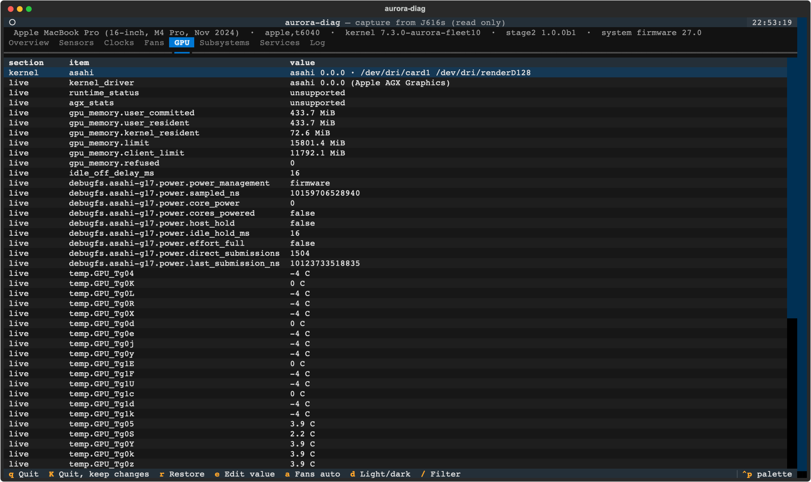 | 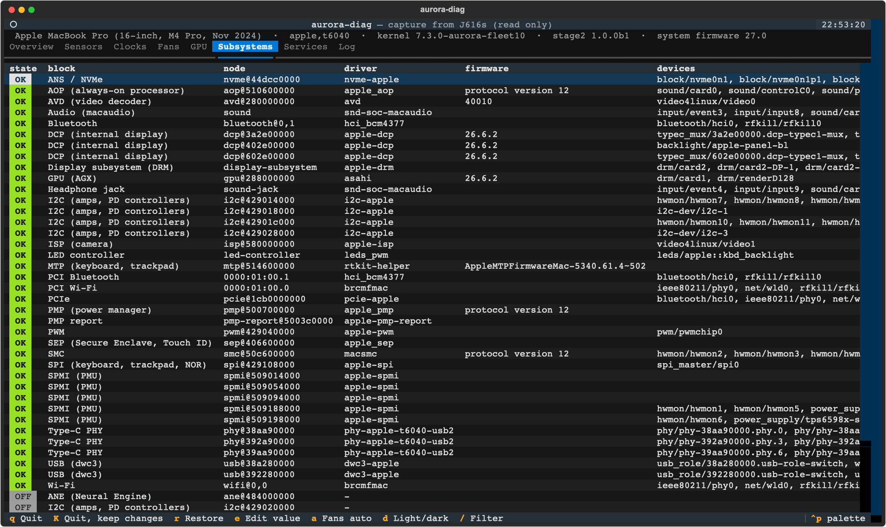 |
| 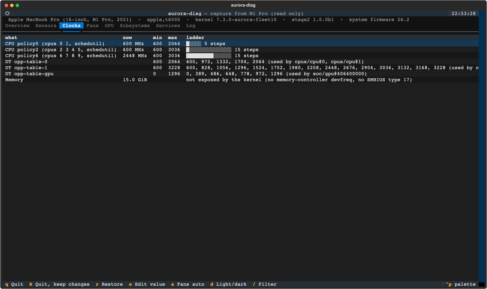 | 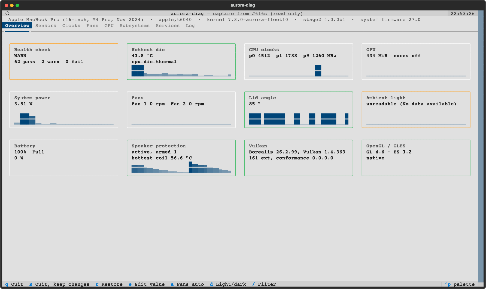 |

Keys: `e` edits the selected writable value on the Sensors tab, `r` restores this session's changes, `a` hands the fans back to the SMC, `/` filters, `q` quits and restores, `K` quits and keeps the changes.

ANE and comparison rows refresh with the status probes every 15 seconds, using the same in-place cell updates as the other tables. Captures include both panels and remain viewable without hardware. Older captures show that ANE data was not collected.

## ANE status and saved benchmarks

`aurora-diag ane --json` emits one document; `list --source ane` exposes read-only readings. `check --only ane --no-api --json` gives agents pass/warn/fail rows. Missing telemetry, no device, unreadable counters, incomplete client visibility and absent saved benchmarks warn. An unbound/missing device node, a wedged engine, a runtime power error, or a failed saved correctness result fails. Nonzero cumulative error counters warn; they do not establish a new fault. Runtime suspension is normal and passes health checks. `snapshot` stores only stable ANE identity/firmware; `diff` and `check --expect` detect a lost ANE driver/device.

Client counts come from `client_count`/`clients` when exposed, otherwise unique DRM client IDs from open descriptors for that device. Restricted `/proc` produces a lower bound (`clients_complete: false`), or unknown when no client is visible. No process names or arguments are collected. Firmware may come from a driver attribute or DT `apple,firmware-version`; the source is shown because a DT version does not confirm running firmware. Fields the driver does not expose stay unknown. An unknown chip is never guessed to be a newer generation.

Discovery also walks the live device tree and platform bus, so disabled nodes and failed probes remain visible without an accelerator class device. Missing DT `status` means `okay`; unreadable status stays unknown. T8140 maps to H17. Each diagnostic warning or failure names its cause and a repair, including the actual owning group for denied files.

The optional ANE performance attributes (https://github.com/aurora-silicon/linux/pull/684) are reported verbatim: `performance_level` is a requested level (0 to 5), `memory_vote` is requested average/peak bandwidth in decimal kB/s, and `performance_error` is zero or a negative errno. `unsupported` is distinct from a zero vote; absent attributes on older kernels are null. A negative transition errno fails health. These values are requests, not measured clock or memory frequencies.

The tool never opens an accelerator device, starts an ANE workload, boots firmware or resets an engine. If omarchy-ane-tools output has been saved, it reads `/var/lib/omarchy-ane-tools/last-benchmark.json`; `AURORA_DIAG_ANE_BENCHMARK=/path/result.json` selects another file. The packaged `omarchy-ane-smoke` prints JSON to stdout; save its output from a separate run. It currently does not persist a result automatically. The reader accepts its `name`, `chip`, numeric `die`, `available`, `errors`, `min_ms` and `median_ms` fields, and associates the result with exactly one device. Files are limited to 64 KiB and only documented fields are retained. `saved_at` is the file modification time, not proof of a fresh run. Producers should replace saved files atomically.

The bundled macOS baseline contains MobileNetV1 alpha 1.0, 224x224 FP16 random-weight results: 3309 inf/s and 0.302 ms p50 at batch 1; 3788 images/s and 2.108 ms per batch at batch 8. The smoke test's add-fixture is a different workload and receives no MobileNet delta. A compatible benchmark export must explicitly identify `device`, `model: "mobilenetv1-1.0-224-random"`, `precision: "fp16"`, `batch: 1` or `8`, `ok: true`, `p50_ms`, and/or `throughput_per_s` (images per second for batch 8); it can include `generated` and `errors`. See [SCHEMA.md](docs/SCHEMA.md) for an example.

`AURORA_DIAG_MACOS_BASELINE=/path/baseline.json` overrides the bundled export using the same schema. A different machine shows baseline values but suppresses deltas. Live power and temperature are observations beside an idle-on-AC baseline; check the displayed context before interpreting them. The panel never treats lower current power as a performance win or substitutes historical Linux baseline numbers for live readings. CPU ladder comparisons concern advertised states, not achieved clocks. CPU/GPU throughput, storage, network, video and other load benchmarks are not launched by this view.

## Changing things

Anything writable the kernel exposes can be changed through one write path. It reads the old value, writes, reads back, logs the change with before and after values, and records it in a journal under `/run/aurora-diag`. `aurora-diag restore` puts everything back (newest change first), `restore --from-log [--session ID]` does it from the log when the journal is gone, and `--hold`, the dashboard and the fan guard put their changes back when they exit.

    aurora-diag set ID VALUE [--hold] [--dry-run]
    aurora-diag fan list | set N RPM | auto
    aurora-diag haptic show | set PRESS RELEASE
    aurora-diag kbd [N]
    aurora-diag display status | notch on|off | brightness N|N% | reprobe CONNECTOR
    aurora-diag journal | restore [--from-log]

These stay read only whatever you ask:

- speaker protection: speakerguardd and speakersafetyd state, every ALSA control on the speaker path (volumes, unlock, V/I sense, amp gain, routing) and the speaker drivers' module parameters. The tool never opens a PCM, so it cannot play or record audio.
- thermal zone mode, emulated temperatures, critical and hot trip points
- battery and charger limits (only the charge thresholds and `charge_behaviour` can change)
- the boot chain: EFI variables, NVRAM, SPI NOR, block devices
- bind, unbind, remove and similar actions, `/sys/power`, debugfs and `/proc`

A machine whose device tree is not an Apple silicon one is read only unless you pass `--allow-unknown`.

**Fans.** `fan set` needs a kernel whose macsmc-hwmon probed with fan control enabled (`fanN_target` writable). Every manual speed runs under a guard that hands the fans back to the SMC when its lease runs out (10 minutes by default), when a die temperature passes `--max-temp` (90 C by default, never above 100 C), when die temperatures cannot be read for 5 seconds, or when the guard stops for any reason. It runs as a transient systemd unit whose `ExecStopPost` hands the fans back even after a crash. Fanless machines are refused.

**Trackpad click.** `haptic set PRESS RELEASE` changes the strength byte of the actuator's feature reports 0x22 and 0x23 live, on any HID device named as an actuator (MTP and SPI trackpads).

**Notch.** appledrm decides the notch when the DCP probes, so `display notch` takes effect from the next boot and the tool says so.

## Logs

As root the log goes to `/var/log/aurora-diag/aurora-diag.jsonl`, otherwise to `$XDG_STATE_HOME/aurora-diag/`. `aurora-diag log [-f] [--session ID] [--event set]` prints or follows it, `log-path` prints where it is, and `--json` puts the same records on stdout. The events are described in [docs/LOG.md](docs/LOG.md).

## Layout

One module per area, each one a generic discovery over the kernel's interfaces:

| module | role |
| --- | --- |
| `sysfs.py` | defensive reads (never raise, optional timeout), DT property decoding, the fake-root hook for tests |
| `sources.py` | the reading model and the generic class walkers (hwmon, iio, thermal, power supply, ...) |
| `clocks.py`, `gpu.py`, `glprobe.py`, `compliance.py` | clocks and ladders; GPU, Vulkan, GL (glprobe runs in its own process) and spec checks |
| `subsystems.py`, `services.py` | hardware blocks against the device tree; userspace services and Touch ID state |
| `sections.py` | the thirteen categories behind the overview, the drill-downs, `show`, `coverage` and the inventory in check and snapshot |
| `demos.py` | the demo list: discovery, the motion drawing, start and stop, result parsing |
| `kms.py`, `edid.py` | read-only DRM ioctls (connectors, properties, CRTCs, the flattened tree's node order); EDID and DCP dictionary decoders |
| `check.py`, `snapshot.py`, `report.py`, `probe.py` | the agent side: verdicts, snapshots and diffs, bug reports, per-probe deadlines |
| `control.py`, `fans.py`, `haptics.py`, `display.py`, `audio.py` | the write path, its policy and journal; fan guard, click strength, display, speaker protection readout |
| `dashboard.py`, `tui_textual.py`, `tui.py` | dashboard data, the Textual UI, the curses fallback |
| `cli.py`, `log.py` | commands and the JSON-lines log |

## Tests

    make check

The tests run against a fake `/sys`, `/proc` and device tree (`AURORA_DIAG_ROOT`), so they need no hardware and no root.

## Packages

Opt-in packages for Fedora (`packaging/fedora`), Arch (`packaging/arch`) and NixOS (`packaging/nix`). Python 3 is the only hard dependency. Textual, vulkan-tools, alsa-utils and Mesa's demos are recommended.

## Licence

MIT
